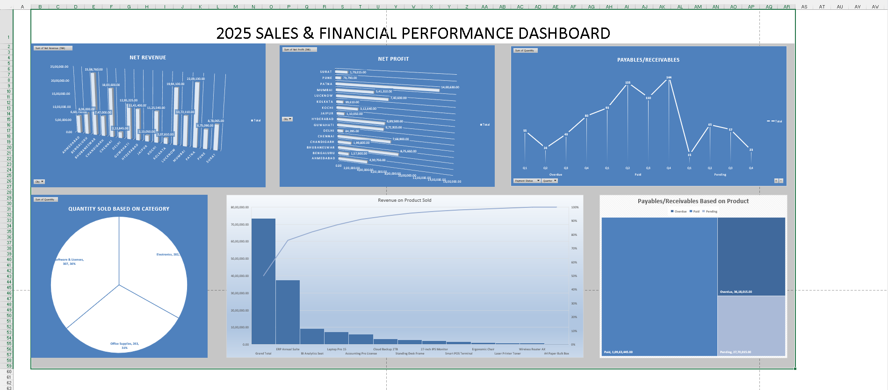
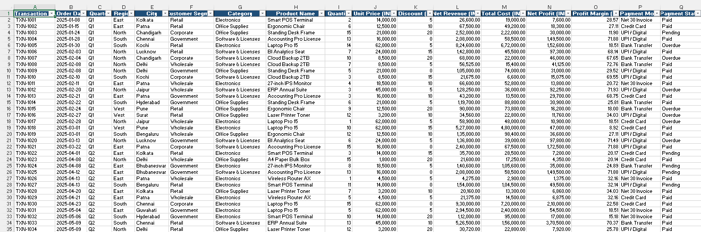
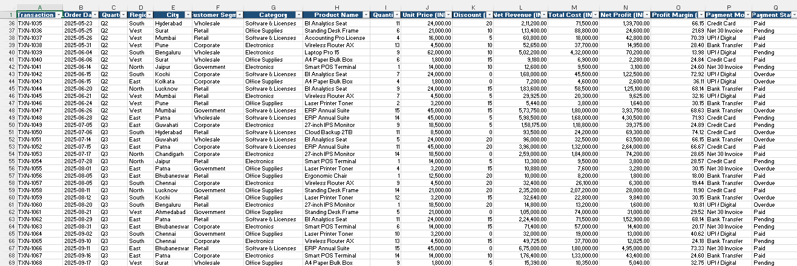
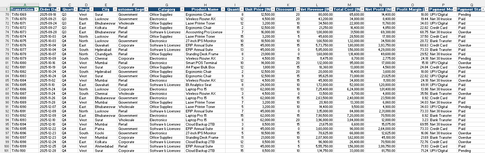

# Sales-Excel-Dashboard
Interactive Excel sales dashboard tracking regional revenue, top-performing products, and monthly growth trends using PivotTables and slicers.
# 📊 2025 Sales & Financial Performance Dashboard

An interactive Microsoft Excel dashboard built to analyze **100 B2B and retail transactions** across India in 2025. The workbook transforms raw transaction logs into executive KPIs, tracking city-level revenue, product profitability, category volume, and accounts receivable health.



---

### 📋 Raw Data Sheet Preview




---

## 🎯 Project Overview
This project provides an end-to-end financial and operational overview of 2025 sales across four regions (**North, South, East, West**) and three customer segments (**Retail, Corporate, Government, Wholesale**). Using dynamic PivotTables and slicers, stakeholders can monitor cash collection bottlenecks alongside top-performing product lines.

## 📈 Executive Summary & Key Metrics (FY 2025)
* **Total Net Revenue:** ₹1,73,51,475 (₹1.74 Cr)
* **Total Net Profit:** ₹73,42,475 (₹73.42 Lakhs)
* **Overall Profit Margin:** 42.32%
* **Total Units Sold:** 852 units across 100 transactions

---

## 💡 Key Business Insights
* **Software Drives Over Half of All Profit:** **ERP Annual Suite** is the standout profit engine, generating **₹37,63,500** (51.26% of total company profit). Combined with **BI Analytics Seat** (₹9,19,600) and **Accounting Pro License** (₹6,13,300), the *Software & Licenses* category accounts for the vast majority of net earnings while leading unit volume at **307 units**.
* **High-Revenue vs. High-Margin Cities:** **Bhubaneswar** leads all 16 cities in top-line revenue at **₹23,08,760** (13.31% of total revenue), closely followed by **Patna** (₹22,09,130). However, Patna outperforms Bhubaneswar in bottom-line profitability (**₹14,00,630** vs. **₹8,75,660**) due to a higher mix of zero-discount software license sales.
* **Accounts Receivable & Cash Flow Risk:** While **63.18%** of revenue (**₹1,09,63,445** across 482 units) has been collected (`Paid`), **20.85%** (**₹36,18,015** across 210 units) is currently **Overdue**, and **15.96%** (**₹27,70,015** across 160 units) remains **Pending**. Overdue unit volume spiked significantly in **Q4 (80 units)** compared to Q2 (26 units), signaling a need for tighter year-end credit follow-ups.
* **Hardware Volume vs. Margin Trade-off:** **Laptop Pro 15** generates substantial top-line revenue, but high unit costs and discounts (up to 20%) compress margins to between 3.23% and 22.58%, resulting in **₹7,53,400** in net profit.

---

## 📊 Dashboard Breakdown & Pivot Views
The workbook organizes the raw dataset into six core analytical views:
1. **Net Revenue Earned by City:** Compares top-line performance across 16 Indian cities (from Bhubaneswar at ₹23.09L to Kolkata at ₹2.08L).
2. **Net Profit Earned by City:** Highlights regional margin efficiency across urban hubs.
3. **Units Sold by Category:** Tracks volume distribution across *Software & Licenses* (307), *Electronics* (282), and *Office Supplies* (263).
4. **Profit by Product:** Ranks all 11 SKUs by net profit contribution.
5. **Receivables & Payables by Quarter (Volume):** Tracks *Paid*, *Pending*, and *Overdue* unit quantities across Q1–Q4.
6. **Receivables & Payables by Value (INR):** Summarizes total cash collected vs. outstanding receivables.

---

## 🛠️ Excel Tools & Techniques Used
* **Data Structuring:** Formatted transactional records (`TXN-1001` to `TXN-1100`) with standardized currency (INR), discount calculations, and margin formulas.
* **PivotTables:** Built multi-dimensional summaries aggregating revenue, profit, and unit volume across geography, product SKUs, and payment statuses.
* **Data Visualization & Interactivity:** Designed KPI summary cards, bar/column charts, and interactive slicers for filtering by **Quarter**, **Region**, **Customer Segment**, and **Payment Mode**.

---

## 📂 Repository Structure
```text
├── data/
│   └── 2025_sales_transactions.csv       # Raw 100-row transaction dataset
├── assets/
│   └── dashboard-preview.png             # Screenshot of the final dashboard
├── 2025_Sales_Financial_Dashboard.xlsx   # Interactive Excel workbook & PivotTables
└── README.md                             # Project documentation
```

## 🚀 How to Use
1. Download `2025_Sales_Financial_Dashboard.xlsx` from this repository.
2. Open the file in **Microsoft Excel** (Excel 2016 or later recommended).
3. Use the interactive **Slicers** on the dashboard tab to filter metrics by Region, Quarter, Customer Segment, or Payment Status.
4. To update the dashboard after adding new rows to the data table, navigate to **Data > Refresh All** in the Excel ribbon.
